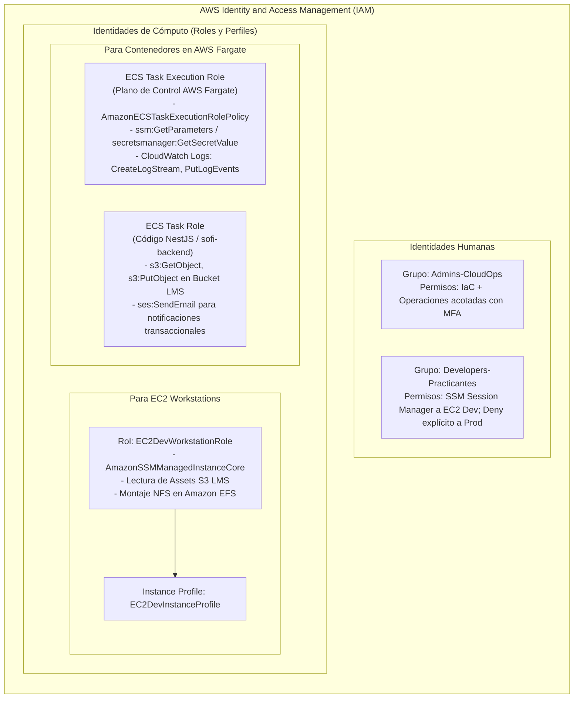
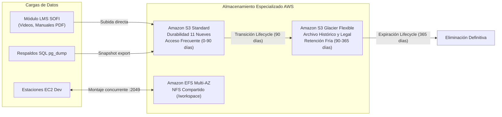
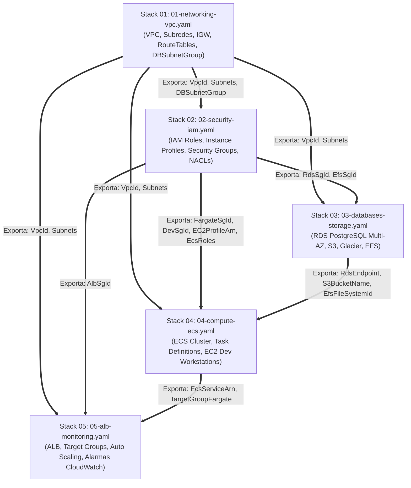

# Arquitectura Cloud AWS — Documento Maestro de Consolidación y Especificación Técnica

> **Blueprint Técnico y Guía de Implementación Canónica**  
> **Proyecto:** Diseño e Implementación de Arquitectura Cloud Escalable, Tolerante a Fallos y de Alta Disponibilidad en AWS  
> **Organización:** APM Inversiones EIRL · Sistema SOFI y Clientes Comerciales B2B  
> **Institución Académica:** SENATI — Formación Continua y Práctica Profesional  
> **Diagrama de Referencia Central:** `docs/fase-3/diagrama_arquitectura_global_aws_v2.drawio`  
> **Fuente Teórica de Verdad:** Entregables Fase 1 (Diagnóstico/CAF), Fase 2 (Core/Persistencia) y Fase 3 (Escalabilidad/Operaciones/IaC)  
> **Objetivo del Documento:** Servir como especificación técnica definitiva para la ejecución secuencial de las 5 fases de la Guía Práctica de Implementación CloudFormation (`implementacion/guia/Plan de Implementacion de Servicios Cloud con AWS-3.pdf`).

---

## 1. Visión Ejecutiva, Diagnóstico y Transformación Tecnológica

### 1.1 Perfil de la Organización y Cargas de Trabajo
**APM Inversiones EIRL** es una compañía tecnológica B2B que opera en tres frentes críticos:
1. **Plataforma Propietaria SOFI:** Ecosistema integral de gestión académica y de talento para practicantes que consta de:
   - Frontend web en Next.js (SSR / Static).
   - Backend API REST en NestJS con ORM Prisma y PostgreSQL.
   - Bot de automatización en Discord (Node.js) para control de asistencia, reportes diarios y notificaciones.
2. **Servicios Web Comerciales B2B:** Portales y tiendas para clientes externos corporativos (ej. *Reflexo Perú*, *Arte & Ideas*).
3. **Servicios de Hosting y Soporte Gestionado (MRR):** Compromiso contractual de alta disponibilidad y soporte continuo.

### 1.2 Diagnóstico Crítico: El Servidor VPS Monolítico (Hetzner Cloud)
Previo a esta arquitectura, todos los servicios productivos y de desarrollo operaban en un **único Servidor Privado Virtual (VPS)** en Alemania:
* **Especificaciones:** 3 vCPUs AMD EPYC, 3.7 GiB RAM, 0 B Swap, 75 GB SSD ($16 USD/mes).
* **Limitaciones Críticas Diagnosticadas:**
  - **Punto Único de Falla (SPOF):** La caída del nodo físico dejaba fuera de servicio tanto a SOFI como a la totalidad de clientes comerciales.
  - **Contención de Recursos:** El motor de base de datos PostgreSQL competía por la memoria RAM con el backend NestJS y los navegadores headless de automatización, provocando congelamientos por *Out-Of-Memory (OOM)*.
  - **Cero Elasticidad:** Imposibilidad de absorber picos de tráfico durante campañas publicitarias de los clientes.
  - **Vulnerabilidad Perimetral Severa:** Puerto administrativo SSH (22) abierto a la Internet pública con autenticación mediante contraseñas y llaves dispersas en laptops personales de practicantes.
  - **Pérdida de Datos Potencial:** Respaldos manuales alojados en el mismo disco rígido del servidor, sin redundancia geográfica ni recuperación en el punto en el tiempo (PITR).

---

## 2. Ficha Técnica Maestra y Matriz de Parámetros Globales

Para garantizar la interoperabilidad de las plantillas CloudFormation en las 5 fases de implementación, se fija el siguiente estándar de convención y nomenclatura:

### 2.1 Identificadores de Entorno y Región
* **Región AWS Principal:** `us-east-1` (US East - N. Virginia).
* **Zonas de Disponibilidad (Multi-AZ):** `us-east-1a` y `us-east-1b`.
* **Prefijo Canónico de Recursos:** `apm-sofi-prod` (Producción) / `apm-sofi-dev` (Desarrollo).

### 2.2 Topología de Red Amazon VPC (`10.0.0.0/16`) — Fase 1 Implementada
La red base de la organización divide el espacio de direcciones en 7 subredes Multi-AZ con estricta segregación funcional:

| Subred CloudFormation | Zona de Disponibilidad | Bloque CIDR | Tipo / Acceso | Propósito Arquitectónico |
| :--- | :---: | :---: | :---: | :--- |
| `PublicSubnetA` | `us-east-1a` | `10.0.1.0/24` | Pública (IGW) | Application Load Balancer (ALB), NAT Gateway A. |
| `PublicSubnetB` | `us-east-1b` | `10.0.2.0/24` | Pública (IGW) | ALB Ingress Multi-AZ, NAT Gateway B. |
| `PrivateAppSubnetA` | `us-east-1a` | `10.0.10.0/24` | Privada (NAT) | Contenedores ECS Fargate (`sofi-backend`, `sofi-web`, Bot). |
| `PrivateAppSubnetB` | `us-east-1b` | `10.0.20.0/24` | Privada (NAT) | Contenedores ECS Fargate Multi-AZ y Clientes B2B. |
| `PrivateDevSubnetA` | `us-east-1a` | `10.0.30.0/24` | Privada (SSM) | Estaciones EC2 Dev Linux / Workstations de practicantes. |
| `IsolatedDbSubnetA` | `us-east-1a` | `10.0.100.0/24` | Aislada (No Internet) | Instancia Primaria Amazon RDS for PostgreSQL 16. |
| `IsolatedDbSubnetB` | `us-east-1b` | `10.0.101.0/24` | Aislada (No Internet) | Réplica Síncrona Standby Amazon RDS for PostgreSQL. |

---

## 3. Mapeo Maestro: Arquitectura Final (Fase 3 Teórica) vs. Las 5 Fases de Implementación Práctica

A continuación se detalla cómo los componentes del diagrama consolidado `diagrama_arquitectura_global_aws_v2.drawio` se distribuyen e implementan a lo largo de las 5 fases de la Guía Oficial de AWS:

```
[Guía Fase 1: Networking]            --> 01-networking-vpc.yaml      (VPC, 7 Subredes, IGW, Tablas de Ruta) - [COMPLETADO]
[Guía Fase 2: Identidad y Seguridad] --> 02-security-iam.yaml        (IAM Roles, Security Groups, NACLs)
[Guía Fase 3: Bases de Datos y S3]  --> 03-databases-storage.yaml   (RDS PostgreSQL Multi-AZ, S3, Glacier, EFS)
[Guía Fase 4: Cómputo y ECS Fargate] --> 04-compute-ecs.yaml         (Cluster ECS, Tareas Fargate, EC2 Dev SSM)
[Guía Fase 5: ALB, Scaling y Alertas]--> 05-alb-monitoring.yaml      (ALB, Target Groups, Auto Scaling, CloudWatch/SNS)
```

---

### FASE 1 DE LA GUÍA: Redes y Aislamiento Perimetral (Networking)
* **Estado:** **Completado y Verificado** en `implementacion/01-networking/01-networking-vpc.yaml`.
* **Componentes Materializados:**
  1. VPC con DNS Hostnames y DNS Resolution habilitados.
  2. 7 Subredes Multi-AZ con etiquetado estandarizado.
  3. Internet Gateway (IGW) enlazado a las subredes públicas.
  4. Tablas de ruteo independientes:
     - Tabla Pública: Ruta `0.0.0.0/0` hacia el IGW.
     - Tabla Privada Cómputo: Preparada para salida vía NAT Gateway.
     - Tabla Privada Dev: Aislada con rutas internas y acceso a VPC Endpoints.
     - Tabla Aislada de Base de Datos: Tráfico estrictamente local intra-VPC (`10.0.0.0/16`), sin salida externa.
  5. `DBSubnetGroup` multi-zona (`IsolatedDbSubnetA` + `IsolatedDbSubnetB`).
  6. Entorno automatizado de validación con instancias mínimas (`t3.micro` según guardrail de AWS Academy).

---

### FASE 2 DE LA GUÍA: Gestión de Identidad (IAM) y Seguridad Perimetral

Esta fase establece las barreras de contención lógicas antes de desplegar cualquier motor de base de datos o cómputo.

#### 1. Arquitectura de Identidades AWS IAM (Principio de Menor Privilegio - PoLP)
Se elimina toda asignación directa de permisos a usuarios individuales y se establece una separación taxativa entre identidades humanas e identidades de cómputo:



* **Compatibilidad AWS Academy / Learner Lab:** Las plantillas de IAM incluirán el parámetro `UseExistingLabRole` (booleano). Si se ejecuta en entornos donde las Service Control Policies (SCP) bloquean la creación de roles IAM, el stack se asociará limpiamente al rol preexistente `LabRole` sin fallar.

#### 2. Matriz de Grupos de Seguridad (Security Groups - Stateful)
Cada capa de seguridad referencia exclusivamente el identificador del grupo precedente, eliminando la apertura indiscriminada de rangos IP:

| Security Group | Reglas Inbound (Entrada) | Reglas Outbound (Salida) | Propósito Técnico |
| :--- | :--- | :--- | :--- |
| **`sg-sofi-alb-public`** | `TCP 80` desde `0.0.0.0/0`<br>`TCP 443` desde `0.0.0.0/0` | `TCP 3000` (Web) y `TCP 8080` (API / Clientes B2B) hacia `sg-sofi-fargate-tasks` | Recepción de tráfico web seguro filtrado desde CloudFront / Clientes. |
| **`sg-sofi-fargate-tasks`**| `TCP 3000` (`sofi-web`) desde `sg-sofi-alb-public`<br>`TCP 8080` (`sofi-backend` y `Clientes B2B`) desde `sg-sofi-alb-public` | `TCP 5432` hacia `sg-sofi-rds-postgres`<br>`HTTPS 443` hacia VPC Endpoints / NAT | **Cero acceso público directo**. Solo recibe peticiones enrutadas por el ALB. |
| **`sg-sofi-rds-postgres`** | `TCP 5432` exclusivo desde `sg-sofi-fargate-tasks`<br>`TCP 5432` opcional desde `sg-sofi-ec2-dev` | **Ninguna salida permitida (Blindaje RDBMS)** | Base de datos completamente aislada de la Internet pública. |
| **`sg-sofi-ec2-dev`** | **Ningún puerto de entrada (Zero Open Inbound Ports / Cero SSH :22)** | `HTTPS 443` hacia VPC Endpoints (SSM/ECR/S3)<br>`TCP 2049` (NFS) hacia `sg-sofi-efs-mount` | Estaciones de desarrollo administradas por túnel cifrado TLS vía SSM. |
| **`sg-sofi-efs-mount`** | `TCP 2049` exclusivo desde `sg-sofi-ec2-dev` | Tráfico local intra-VPC | Montaje concurrente y compartido del sistema de archivos NFS. |
| **`sg-sofi-vpc-endpoints`**| `HTTPS 443` desde CIDR VPC (`10.0.0.0/16`) | Tráfico interno hacia servicios AWS | Permite tráfico privado hacia SSM, ECR y S3 vía AWS PrivateLink. |

#### 3. Network ACLs (NACLs - Stateless)
* **NACL Pública:** Permite entrada en puertos `80`, `443` y puertos efímeros (`1024-65535`) de retorno; salida abierta a puertos efímeros e Internet.
* **NACL Privada (Cómputo):** Entrada restringida al tráfico VPC interno y respuestas efímeras; salida permitida para consumo de APIs y repositorios.
* **NACL Aislada (Datos):** Entrada estrictamente limitada al puerto `5432` proveniente del CIDR de las subredes privadas de cómputo (`10.0.10.0/24`, `10.0.20.0/24`, `10.0.30.0/24`); salida únicamente en puertos efímeros hacia esos mismos bloques.

---

### FASE 3 DE LA GUÍA: Despliegue de Bases de Datos y Almacenamiento

Esta fase materializa la persistencia relacional administrada y la jerarquía de almacenamiento elástico.

#### 1. Amazon RDS for PostgreSQL 16 (Base de Datos Primaria y Alta Disponibilidad)
* **Motor y Versión:** PostgreSQL 16.x.
* **Clase de Instancia:** `db.t3.micro` (1 vCPU, 1 GiB RAM), balanceada para cargas de inicio bajo el Free Tier de AWS.
* **Almacenamiento:** 20 GB en discos SSD `gp3` con autoscaling de almacenamiento hasta 100 GB.
* **Topología Multi-AZ:** Despliegue síncrono activo-pasivo:
  - Nodo Primario en `IsolatedDbSubnetA` (`us-east-1a`).
  - Nodo Standby Pasivo en `IsolatedDbSubnetB` (`us-east-1b`).
  - **Mecanismo de Conmutación:** Failover transparente por DNS administrado por AWS en menos de 60 segundos si la zona primaria se degrada.
* **Respaldo y Recuperación (RPO / RTO):**
  - Snapshots automatizados diarios replicados a Amazon S3.
  - **Point-in-Time Recovery (PITR):** Capacidad de restaurar transacciones al segundo exacto dentro de una ventana de retención de **hasta 35 días** (7 días configurados por defecto en plantilla base), protegiendo ante corrupción lógica o borrado accidental de datos.
  - Cifrado en reposo obligatorio mediante **AWS KMS** (`AES-256`).

#### 2. Ecosistema de Almacenamiento Jerárquico: S3 + Glacier + EFS
Se descarta el uso del disco local del servidor para almacenar activos y se implementa una arquitectura desacoplada:



* **Amazon S3 (Bucket LMS de SOFI):**
  - Versionado activo para trazabilidad y protección anti-borrado.
  - Cifrado por defecto con SSE-S3 o SSE-KMS.
  - Bloqueo de Acceso Público (*Block Public Access*) al 100%. La distribución web se realiza exclusivamente mediante **CloudFront Origin Access Control (OAC)**.
* **Amazon EFS (Elastic File System):**
  - Desplegado en modo Multi-AZ con puntos de montaje (*Mount Targets*) en las subredes privadas.
  - Permite a múltiples desarrolladores compartir carpetas de proyectos y librerías concurrentemente sin clonar repositorios pesados en cada máquina.

---

### FASE 4 DE LA GUÍA: Despliegue de Servicios de Cómputo y Contenedores

#### 1. Cluster Amazon ECS y AWS Fargate (Cargas de Producción)
Se adopta el modelo de contenedores serverless para abstraer la administración del sistema operativo:
* **Cluster:** `cluster-apm-sofi-prod` con métricas avanzadas de **Container Insights** habilitadas.
* **Networking de Contenedor:** Modo `awsvpc`, asignando una Elastic Network Interface (ENI) dedicada y una IP privada dentro de la VPC a cada tarea en ejecución.
* **Definición de Tareas (Task Definitions):**
  - **`sofi-web` (Next.js SSR / Frontend):** 0.25 vCPU / 512 MiB RAM. Target Group en Puerto `3000` (Ruta `/`).
  - **`sofi-backend` (NestJS API + Prisma ORM):** 0.50 vCPU / 1024 MiB RAM. Target Group en Puerto `8080` (Ruta `/api/*`). Consume credenciales de base de datos cifradas desde SSM Parameter Store.
  - **`Bot-Asistencia-APM` (Node.js Discord WebSocket):** 0.25 vCPU / 512 MiB RAM. Socket continuo 24/7 saliente hacia el Gateway de Discord sin timeout ni puertos de entrada abiertos.
  - **`Clientes B2B Desacoplados` (Reflexo Perú & Arte y Ideas):** 0.50 vCPU / 1024 MiB RAM. Target Group en Puerto `8080` (enrutado por Host Headers `*.reflexoperu` / `*.arteideas`) para aislamiento total del tráfico comercial.

#### 2. Amazon EC2 Dev Workstations y VPC Endpoints (AWS PrivateLink)
* **Ubicación de Red:** Subred Privada de Gestión `10.0.30.0/24` (Zona `us-east-1a`).
* **Tipo de Instancia:** `t4g.small` (AWS Graviton2 ARM64, rendimiento en ráfaga *Burstable*, 2 vCPU y 2 GiB RAM) o `t3.micro` (x86 en entornos académicos restringidos).
* **Almacenamiento:** 25 GB EBS `gp3` (3,000 IOPS base sostenidos y 125 MB/s) para lectura veloz de repositorios y `node_modules`.
* **Administración Cero-SSH (Zero Open Inbound Ports):** Acceso seguro a terminal interactiva mediante **AWS Systems Manager (SSM Session Manager)** por túnel HTTPS :443 TLS sin puerto SSH (22) abierto, sin bastiones públicos y sin llaves privadas `.pem`.
* **VPC Endpoints Gestionados (AWS PrivateLink):**
  - **Gateway Endpoint para Amazon S3:** Acceso privado a buckets sin consumir NAT Gateway ni salir a Internet.
  - **Interface Endpoints para Amazon ECR y AWS SSM:** Descarga privada de imágenes Docker y sesiones de terminal cifradas, eliminando costos de transferencia sobre el NAT Gateway.
* **Optimización FinOps:** Apagado automático fuera del horario laboral (160 h/mes · ~$2.70 USD/mes por practicante).

---

### FASE 5 DE LA GUÍA: Integración, Alta Disponibilidad, Monitoreo y FinOps

#### 1. Perímetro de Borde Global (Route 53 + CloudFront) y Application Load Balancer (ALB)
* **Amazon Route 53:** DNS autoritativo global con *Latency Routing* y Health Checks para las zonas hospedadas `sofi.edu.pe`, `reflexoperu.com.pe` y `arteideas.pe` (`DNS :53 UDP/TCP`).
* **Amazon CloudFront (CDN Edge):** Caché perimetral de assets estáticos, descarga SSL/TLS con **AWS Certificate Manager (ACM)** y mitigación Anti-DDoS nativa de Capa 3/4 con **AWS Shield Standard**.
* **Application Load Balancer (ALB) Multi-AZ Ingress:** Alojado en `PublicSubnetA` y `PublicSubnetB`, recibe tráfico filtrado `HTTPS :443` desde el borde con redirección HTTP-to-HTTPS automática:
  - Ruta `/` $\to$ Target Group `sofi-web` (`HTTP :3000`).
  - Ruta `/api/*` $\to$ Target Group `sofi-backend` (`HTTP :8080`, Health Check: `GET /api/health`).
  - Host Headers `*.reflexoperu` / `*.arteideas` $\to$ Target Group `Clientes B2B` (`HTTP :8080`).

#### 2. Mecanismo de Elasticidad: Amazon ECS Auto Scaling
Para soportar variaciones en la concurrencia:
* **Escala Mínima:** 2 tareas Multi-AZ (`us-east-1a` y `us-east-1b`).
* **Escala Máxima:** 6 tareas concurrentes.
* **Políticas Combinadas:**
  - **Target Tracking Scaling:** Mantiene el umbral al **70% de utilización promedio de CPU/RAM** y 1,000 req/min por tarea.
  - **Step Scaling:** Respuesta escalonada agresiva ante picos bruscos e imprevistos de tráfico comercial.

#### 3. Flujo de Streaming de Video Desacoplado (Direct-to-Client)
Diseñado específicamente como estrategia anti-saturación (*Control Plane Ligero + CDN Edge Offloading*):

```
[Usuario / Navegador]
       |
       +--- (1) Control Plane: Petición API (/api/videos/:id) ---> [ALB :443] ---> [sofi-backend :8080]
       |                                                                                    |
       |                                                           (Valida sesión en RDS :5432 y genera URL)
       |<-- (2) Respuesta < 1 KB: Devuelve URL directa de CloudFront -----------------------+
       |        (Cero Proxy: Fargate NUNCA transmite bytes de video ni satura RAM)
       |
       +=== (3) Data Plane: Streaming Directo HLS/MP4 (HTTPS :443) ====> [Amazon CloudFront CDN Edge]
                                                                                     ||
                                                                    (Origen Seguro vía S3 OAC)
                                                                                     \/
                                                                          [Amazon S3 Bucket LMS]
```
* **Ahorro FinOps:** Tareas Fargate 100% libres de sockets pesados y **$0 USD en NAT Gateway** ($0.045/GB) para tráfico multimedia.

#### 4. Observabilidad, Gobierno y Alertas con Amazon CloudWatch y SNS
* **Amazon CloudWatch:** Ingesta de métricas operativas de ECS, ALB, RDS y EC2 en tiempo real; centralización de logs (`awslogs` en `/ecs/sofi-*`) con política de retención de **30 días**.
* **Amazon SNS (`alerta-devops-critica`):** Notificaciones automáticas a Discord / Correo ante:
  1. **CPU > 75%** sostenido en tareas ECS Fargate (o > 80% en pico crítico).
  2. **Tasa de errores HTTP 5XX > 1%** en el Application Load Balancer (o > 10 req/5min).
  3. **Espacio libre de almacenamiento en BD < 20%** o conexiones simultáneas en RDS > 45.
* **FinOps y AWS Trusted Advisor:** Estrategia obligatoria de Tagging (`Environment`, `Project`, `Owner`, `CostCenter`) y auditoría continua de seguridad, rendimiento y cuotas.

---

## 4. Matriz de Trazabilidad e Infraestructura como Código (CloudFormation Stacks)

Para evitar plantillas monolíticas imposibles de depurar, la arquitectura se divide en 5 plantillas desacopladas que se encadenan mediante `Outputs` y la función intrínseca `Fn::ImportValue`:



### Contrato de Exportaciones e Importaciones entre Stacks

| Stack Emisor | Valor Exportado (`Export Name`) | Stack Consumidor | Uso en el Stack Destino |
| :--- | :--- | :--- | :--- |
| **01-Networking** | `apm-sofi-prod-VpcId` | Todos los stacks | Asociación a Security Groups, RDS, ALB y VPC Endpoints. |
| **01-Networking** | `apm-sofi-prod-PublicSubnetA / B` | 05-ALB | Despliegue de los nodos del Application Load Balancer. |
| **01-Networking** | `apm-sofi-prod-PrivateAppSubnetA / B` | 04-Compute | Asignación de interfaces de red ENI para tareas Fargate. |
| **01-Networking** | `apm-sofi-prod-PrivateDevSubnetA` | 04-Compute | Ubicación de las instancias EC2 Workstations de practicantes. |
| **01-Networking** | `apm-sofi-prod-RdsDbSubnetGroup` | 03-Databases | Agrupación de subredes para el cluster Multi-AZ de PostgreSQL. |
| **02-Security** | `apm-sofi-prod-AlbSecurityGroupId` | 05-ALB | Firewall virtual para el balanceador público. |
| **02-Security** | `apm-sofi-prod-FargateSecurityGroupId` | 04-Compute | Aislamiento de tareas de backend y front. |
| **02-Security** | `apm-sofi-prod-RdsSecurityGroupId` | 03-Databases | Restricción de acceso en puerto 5432 exclusivo desde Fargate. |
| **02-Security** | `apm-sofi-prod-EC2InstanceProfileArn` | 04-Compute | Permite a las EC2 Dev operar con SSM sin llaves SSH. |
| **02-Security** | `apm-sofi-prod-EcsTaskExecutionRoleArn`| 04-Compute | Permite a Fargate descargar imágenes de ECR y subir logs. |
| **02-Security** | `apm-sofi-prod-EcsTaskRoleArn` | 04-Compute | Permite al código acceder a S3 y SES con menor privilegio. |
| **03-Databases** | `apm-sofi-prod-RdsEndpointAddress` | 04-Compute | Parámetro `DATABASE_URL` inyectado a la tarea NestJS. |
| **03-Databases** | `apm-sofi-prod-S3LmsBucketName` | 04-Compute | Variable de entorno para subida de archivos multimedia. |
| **04-Compute** | `apm-sofi-prod-BackendServiceArn` | 05-ALB / ASG | Registro como servicio administrado en Auto Scaling. |

---

## 5. Estimación Presupuestal y FinOps (Costo Total de Propiedad - TCO)

La arquitectura fue optimizada meticulosamente para proveer nivel corporativo de alta disponibilidad sin disparar los costos de la empresa:

| Servicio AWS | Configuración Mensual | Costo Estimado (USD) |
| :--- | :--- | :---: |
| **Amazon ECS sobre AWS Fargate** | 2 tareas mínimas `sofi-backend` (0.5 vCPU / 1 GB) ejecutando 24/7. | ~$18.20 |
| **Amazon RDS for PostgreSQL 16** | `db.t3.micro` Multi-AZ con 20 GB `gp3` (Aplica Free Tier 750h el primer año). | ~$0.00 / ~$19.50 |
| **Application Load Balancer (ALB)** | 1 ALB público con 1 LCU promedio mensual. | ~$18.00 |
| **Amazon S3 + Glacier Flexible** | 50 GB Standard + 150 GB Glacier + Políticas de ciclo de vida. | ~$1.85 |
| **Amazon EFS** | 10 GB de archivos de desarrollo compartidos Multi-AZ. | ~$3.00 |
| **Amazon EC2 Dev Workstations** | 1 instancia `t4g.small` / `t3.micro` con apagado programado (160h/mes). | ~$2.70 |
| **Amazon CloudWatch + SSM** | Container Insights básico + Logs retenidos a 30 días + Túneles SSM. | ~$2.00 |
| **Amazon Route 53** | 3 Zonas Hospedadas (`sofi.edu.pe`, `reflexoperu.com.pe`, `arteideas.pe`). | ~$1.50 |
| **TOTAL ESTIMADO MENSUAL (Régimen de Operación Optimizado)** | **~$47.25 – $65.75 USD** |

---

## 6. Cuadro Comparativo: VPS Anterior vs. Arquitectura Target AWS

| Dimensión Técnica | Hetzner VPS Monolítico (Pasado) | Arquitectura AWS Consolidada (Presente) |
| :--- | :--- | :--- |
| **Disponibilidad y Resiliencia** | ~95.0% (Sujeto a falla del hardware o nodo físico). | **> 99.95%** mediante arquitectura Multi-AZ (`us-east-1a` y `us-east-1b`). |
| **Tolerancia a Fallos de BD** | Nula. Base de datos caída significaba pérdida de servicio. | **Automática en < 60s** con Amazon RDS Multi-AZ síncrono. |
| **Cómputo y Escalabilidad** | Estática. Se caía ante picos de concurrencia. | **Elástica Serverless** con ECS Fargate y Auto Scaling (2 a 6 tareas). |
| **Gestión de Identidades** | Llaves SSH en laptops desprotegidas; contraseñas fijas. | **AWS IAM** con PoLP, MFA obligatorio y roles efímeros para cómputo. |
| **Superficie de Ataque** | Puertos 22 (SSH), 80 y 5432 expuestos a la Internet pública. | **Cero puertos de gestión abiertos**. SSM Session Manager y SGs encadenados. |
| **Almacenamiento y Medios** | Disco local de 75 GB con riesgo inminente de saturación. | **S3 elástico (11 nueves de durabilidad)** + Ciclo de vida automático a Glacier. |
| **Transmisión de Video** | Monolito actuaba de proxy, saturando memoria y ancho de banda. | **Direct-to-Client con CloudFront OAC**: Fargate libre de sockets multimedia. |
| **Mantenimiento y Despliegue** | Manual por terminal ("en mi máquina sí funciona"). | **100% Declarativo con AWS CloudFormation** modular y versionado en Git. |

---

## 7. Argumentario Técnico para Sustentación y Exposición

Al defender la arquitectura frente al jurado evaluador, enfatizar estos cuatro argumentos de ingeniería:
1. **Desacoplamiento Estricto:** Explicar cómo la separación del plano de datos (RDS) y el plano de cómputo (Fargate) erradicó las caídas por falta de memoria RAM diagnosticadas en la Fase 1.
2. **Arquitectura Zero-Trust y Cero SSH:** Destacar que ningún servidor ni base de datos posee IP pública ni puerto 22 abierto; la administración se realiza exclusivamente por canales autenticados en IAM vía AWS Systems Manager.
3. **Optimización de Streaming Direct-to-Client:** Subrayar cómo el desacoplamiento entre el plano de control (API de backend) y el plano de datos (CloudFront + S3 vía OAC) ahorra cientos de dólares en NAT Gateway y preserva la memoria de las tareas de cómputo.
4. **Gobierno y Reproducibilidad con IaC:** Demostrar cómo las 5 plantillas CloudFormation permiten recrear la totalidad de la empresa en una nueva región en cuestión de minutos de forma auditada y repetible.
